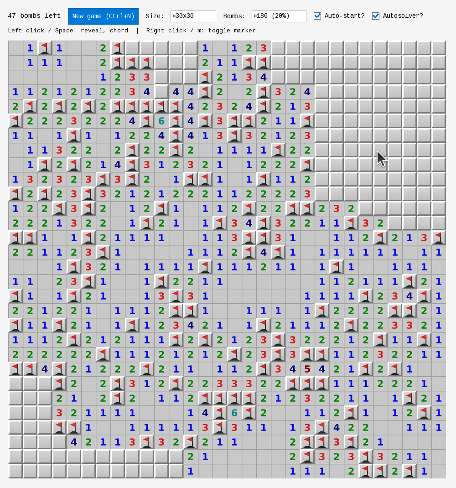

# Minesweeper

[](https://github.com/wolfgang371/minesweeper/actions/workflows/ci.yml)

A minesweeper game written in [Crystal](https://crystal-lang.org/), built on the
[CrymbleUI](https://github.com/wolfgang371/crymbleui) declarative GUI framework.

The game logic (`src/minesweeper.cr`) is fully separated from the view/input
layer (`src/minesweeper-gui.cr`): the GUI only talks to the game through its
public API and its win/lose callbacks.

<p align="center">
  
</p>

## Play in your browser

**[Play Minesweeper online](https://wolfgang371.github.io/minesweeper/)** — the
same game compiled to WebAssembly (crymble-ui's web build), nothing to install.
Needs a current desktop browser (Chrome, Edge, Firefox or Safari) with a mouse
and a keyboard; about 1.4 MB to download.

## Download

Prebuilt binaries are attached to each [GitHub Release](../../releases/latest):

- **Linux** — [`minesweeper-linux-x86_64.AppImage`](../../releases/latest/download/minesweeper-linux-x86_64.AppImage)
  (portable; `chmod +x` then run, or `--appimage-extract-and-run` if you have no FUSE).
- **Windows** — [`minesweeper-windows-x64.exe`](../../releases/latest/download/minesweeper-windows-x64.exe)
  (fully static — no DLLs or VC++ redistributable needed).

## Controls

- **Left click** — reveal a cell. On an already-revealed number, it "chords":
  reveals all neighbours when the number's markers are satisfied.
- **Right click** — toggle a bomb marker. On a revealed number, it also chords.
- **Space** / **m** — keyboard equivalents of a left / right click on the cell
  under the mouse cursor (Space reveals/chords, **m** toggles a marker).
- **Autosolver?** — when checked, the solver repeatedly applies the obvious
  deductions until it gets stuck (or wins/loses).
- **Auto-start?** — when checked (default), every new game starts with a free
  opening: the biggest connected empty region is revealed up front. Takes effect
  on the next new game.
- **New game** (or **F2**) — abandon the current game and start a fresh one.
- **Size** / **Bombs** — board size (8x8 up to 30x30) and bomb count (10–25% of
  the cells, 20% by default). Changing either starts a new game.
- On game over, a popup offers **Yes** (play again) or **No** (quit).

## Build & run

CrymbleUI bundles its own SFML 3.0 / CSFML 3.0 native libraries, so no
system-wide SFML install is needed.

```sh
shards install          # fetches CrymbleUI (+ its bundled native libs)
source setup.sh         # wires up LD_LIBRARY_PATH etc. to the bundled libs
shards build minesweeper
bin/minesweeper
```

During development you can also run directly:

```sh
source setup.sh
crystal run src/minesweeper-gui.cr
```

### Web build (WebAssembly)

The same source also builds as a static web page (crymble-ui >= 1.9,
Linux x86_64 build host):

```sh
bin/crymble-web setup                # once: the WebAssembly toolchain (~1 GB, a few minutes)
bin/crymble-web build minesweeper    # → bin/web/minesweeper/ (the whole site)
bin/crymble-web serve minesweeper    # try it: http://127.0.0.1:8765/
```

See crymble-ui's [docs/WEB.md](https://github.com/wolfgang371/crymbleui/blob/main/docs/WEB.md)
for the toolchain's requirements and what differs from the desktop.

### Windows build (cross-compiled from Linux)

A fully-static `minesweeper.exe` (no DLLs / VC++ redistributable) can be
cross-built from Linux via the MSVC toolchain:

```sh
shards install
./scripts/win-setup-deps.sh     # one-time: Windows SDK + Crystal Windows libs
./scripts/linux_cross_build_win32.sh   # → build/win/minesweeper.exe
```

See [docs/WINDOWS_BUILD.md](docs/WINDOWS_BUILD.md) for details.

## Tests

The game logic has specs:

```sh
crystal spec
```

## License

MIT — see [LICENSE](LICENSE).
